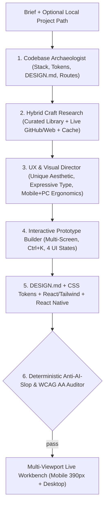

# ui-craft-studio

[](https://github.com/deusbr/ui-craft-studio/actions/workflows/ci.yml)
[](LICENSE)
[](package.json)
[](package.json)

Zero-dependency **Anti-AI-Slop UI/UX & Interactive App Design Studio MCP** for **Mobile** and **Desktop/Web** — built for **Claude Code**, **Codex**, **Gemini CLI**, **Claude Desktop**, and **OpenBot**.

Unlike static screenshot/mockup generators, `ui-craft-studio` **studies your actual codebase first**, researches open-source GitHub design skills and UI patterns, compiles a machine-readable **`DESIGN.md`**, generates **clickable multi-screen & multi-state interactive prototypes** (`populated`, `loading`, `empty`, `error`), exports framework code (`CSS Tokens`, `React + Tailwind`, `React Native`), and runs deterministic **Anti-AI-Slop + WCAG 2.1 AA** audits.

Product-launch briefs now receive a structured, product-specific `creativeDirection` in the generated job and `DESIGN.md`: an authored visual thesis, narrative chapters, one signature interaction, asset-quality rules, performance fallbacks, and cited case-study lessons. Product sites render as a separate responsive story page rather than an app dashboard; audio launches use the `product-story` mode and clearly label the missing GLB instead of passing generic geometry off as the finished product.

### Awarded-Work Research

Recent research across product launch and immersive-site case studies points to a consistent craft pattern: **a recognizable concept tied to the product, a scroll or interaction sequence that reveals useful information, authored assets, and a deliberate low-motion/mobile fallback**. The implementation should borrow these principles, not the case-study layouts:

- [Aether 1 — OFF+BRAND](https://www.itsoffbrand.com/our-work/aether1): product-scale 3D, meaningful chapters, and explicit performance constraints.
- [Sennheiser Orpheus — Artificial Rome](https://artificialrome.com/case/sennheiser-reshaping-excellence): controlled camera movement exposes concrete product details.
- [Building Aether 1 — Codrops](https://tympanus.net/codrops/2025/08/06/building-aether-1-sound-without-boundaries/): technical implementation lessons for 3D, scroll scenes, and mobile/WebGL constraints.

---

## Inspired By & Integrated Open-Source Ecosystem

`ui-craft-studio` synthesizes proven design engineering patterns from leading open-source GitHub projects:
- [`google-labs-code/design.md`](https://github.com/google-labs-code/design.md) & [`google-labs-code/stitch-skills`](https://github.com/google-labs-code/stitch-skills) — Persistent `DESIGN.md` specification and modular UI architecture.
- [`pbakaus/impeccable`](https://github.com/pbakaus/impeccable) — Deterministic Anti-AI-Slop rules, design vocabulary, and project initialization.
- [`nextlevelbuilder/ui-ux-pro-max-skill`](https://github.com/nextlevelbuilder/ui-ux-pro-max-skill) — Multi-platform Mobile (iOS HIG / Material 3) & Desktop design intelligence and typography pairings.
- [`Vanszs/AntiSlopUI`](https://github.com/Vanszs/AntiSlopUI) & [`anthropics/skills`](https://github.com/anthropics/skills) — Negative ban-lists against cliché purple gradients/copy and mandatory edge-state coverage.

---

## Architecture



---

## Quick Start

### 1. Install MCP + Skill across Codex, Gemini CLI, Claude Code, and Claude Desktop
```bash
node bin/ui-craft-studio.cjs install
node bin/ui-craft-studio.cjs status
```

### 2. Study an Existing Codebase & Generate an Interactive Prototype
```bash
# Inspect any local app repository first
node bin/ui-craft-studio.cjs analyze ./my-app

# Research GitHub UI/UX skills & patterns (curated + live GitHub/Wikipedia)
node bin/ui-craft-studio.cjs research "fintech dark workspace"

# Generate DESIGN.md + clickable Mobile & Desktop prototype + framework shells
node bin/ui-craft-studio.cjs design "Freelancer treasury & invoice workspace" --project ./my-app --platforms mobile,desktop
```

### 3. Launch the Local Multi-Viewport Workbench
```bash
node bin/ui-craft-studio.cjs web --port 4322
```
Open `http://127.0.0.1:4322` to interact with **Split Mobile (390px) + Desktop (1440px)** live previews, switch between `populated / loading / empty / error` states, trigger `Ctrl+K` command palette, generate unique variants, and copy/export `DESIGN.md` + code.

### 4. MCP Tools, Resources & Prompts (`bin/mcp-server.cjs`)
- **10 Tools:** `design_list_crew`, `design_inspect_project`, `design_research_patterns`, `design_create_prototype`, `design_regenerate_variant`, `design_audit_anti_slop`, `design_export_to_project`, `design_get_job`, `design_list_jobs`, `design_start_web`.
- **Resources:** `design://catalog/directions`, `design://catalog/github`, `design://catalog/ban-list`, `design://playbook`.
- **Prompts:** `study-and-design-app`, `anti-slop-audit-repo`.

---

## Development & Tests

```bash
npm run check
npm test
```

## License

MIT — see [`LICENSE`](LICENSE).
